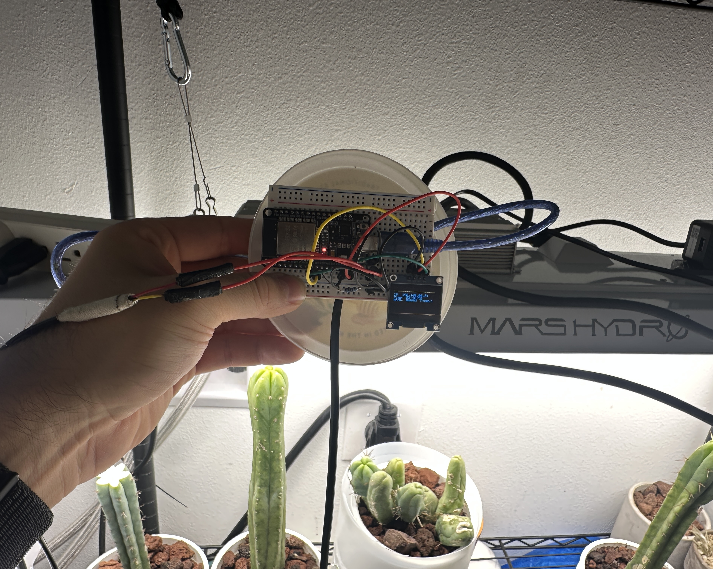
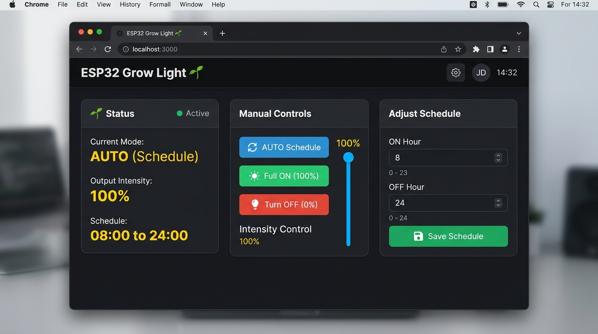
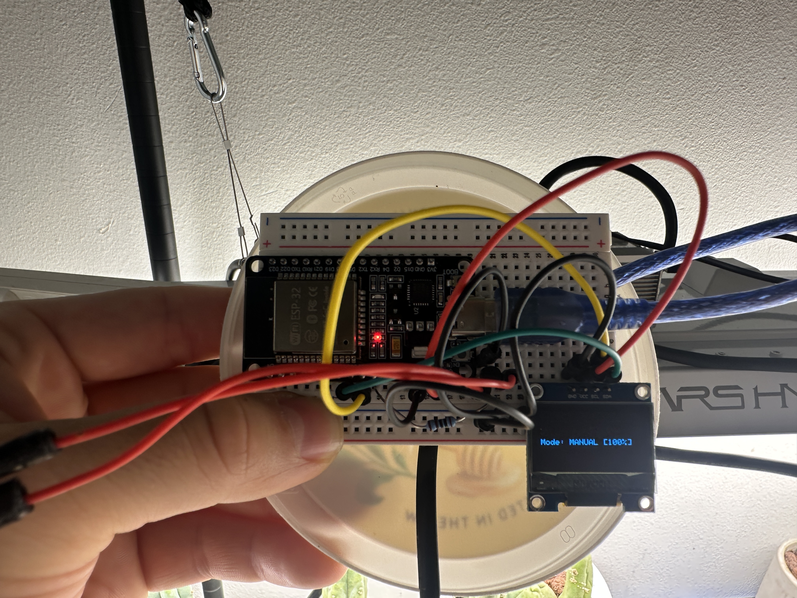
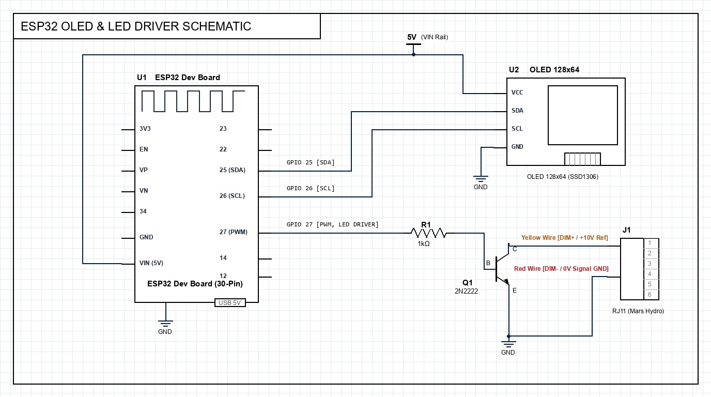
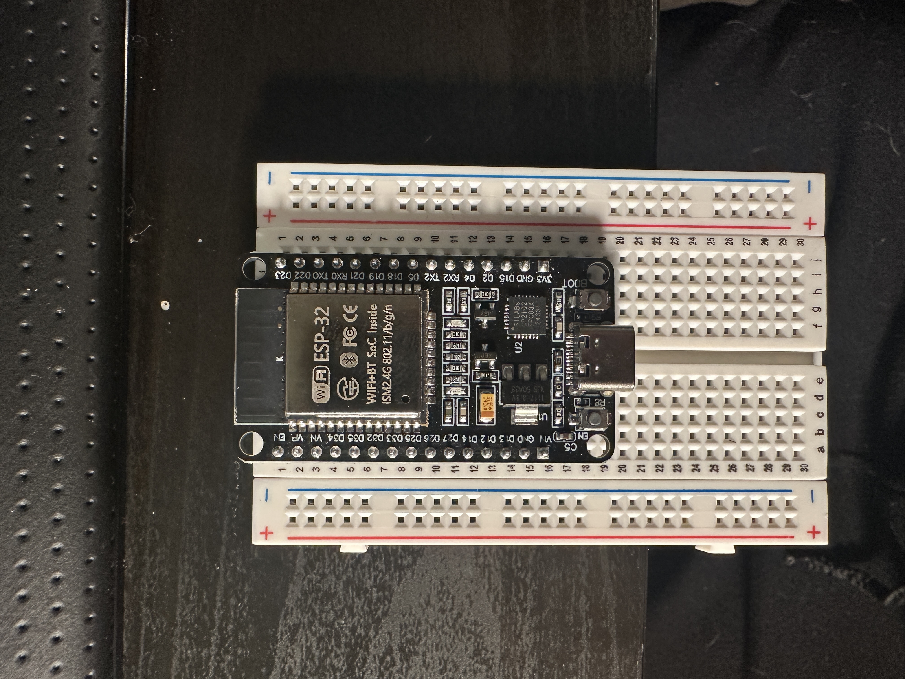
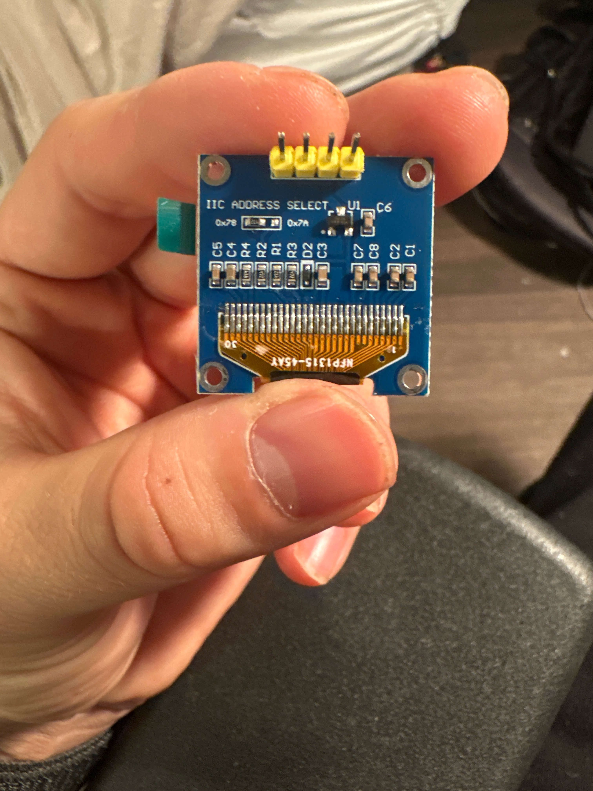
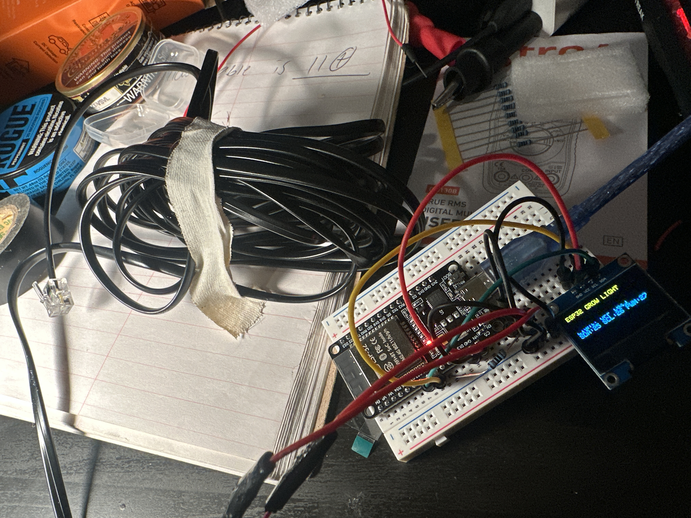

# ESP32 Automated 0–10V LED Light Controller & Web Dashboard

An open-source, IoT-enabled automated lighting controller and web dashboard built on the ESP32 microcontroller for LED grow light drivers equipped with 0–10V / PWM external dimming ports (such as the Mars Hydro TSL 2000 series).

This project utilizes low-side NPN transistor switching to drive the LED driver's internal 10V dimming reference line safely without cutting high-voltage AC mains power. Real-time scheduling is synchronized automatically via Network Time Protocol (NTP) over 2.4GHz Wi-Fi, while an onboard HTTP Web Server serves a responsive mobile-friendly dashboard for live manual overrides, brightness control, and schedule adjustments. Real-time status and network diagnostics are displayed on an onboard 0.96" I2C OLED screen.

---

## Visual Showcase

| System in Action (Mars Hydro TSL 2000) | Embedded Web Dashboard (Port 80) |
| :---: | :---: |
|  |  |
| **Live Deployment:** ESP32 controller actively driving Mars Hydro TSL 2000 grow light over plant canopy with real-time OLED telemetry | **Browser Dashboard:** Port 80 Web GUI with mode toggle (AUTO/MANUAL), 0–100% dimmer slider & live schedule configuration |

---

## Key Features

- **Non-Invasive Low-Voltage Control:** Interfaces directly with the fixture's external RJ11/RJ12 0–10V control port, eliminating hazardous 120V/240V AC relay switching.
- **Embedded Web Dashboard:** Serves a mobile-responsive dark-themed Web GUI directly from the ESP32 (Port 80) for manual overrides, smooth 0–100% dimming, and live schedule re-configuration.
- **NTP Time Synchronization:** Automatically fetches accurate local time over Wi-Fi on boot, eliminating clock drift without requiring external hardware RTC modules.
- **Midnight Wrap-Around Schedule Logic:** Supports standard daytime photoperiods as well as overnight or midnight-boundary schedules (e.g., 8:00 AM to 12:00 AM Midnight).
- **Inverted PWM Dimming Engine:** Leverages ESP32 hardware PWM (`ledc`) to switch an NPN low-side transistor for smooth 0–100% duty cycle dimming.
- **Onboard Status Display:** Drives a 0.96" SSD1306 OLED display over custom I2C pins (GPIO 25/26) to show IP address, NTP clock time, active control mode (AUTO/MANUAL), and target output percentage.
- **Standalone 24/7 Operation:** Code persists in non-volatile flash memory—boots automatically from any standard 5V USB wall charger with automatic Wi-Fi reconnect and schedule recovery.

---

## Hardware Architecture & Circuit Layout

| Hardware Breadboard Close-Up |
| :---: |
|  |
| **Active Breadboard Assembly:** ESP32, 0.96" OLED (`Mode: MANUAL [100%]`), 2N2222 NPN transistor, 1 kΩ base resistor & RJ11 wires |

### Circuit Schematic Diagram



### Component Breakdown & Pinout

| ESP32 Breadboard Placement (Rows 1–19) | 0.96" I2C OLED Display Module (Back View) |
| :---: | :---: |
|  |  |
| **ESP32 Dev Board:** 30-pin footprint spanning breadboard rows 1–19; accessible pins include GPIO 25 (Row 8), 26 (Row 9), 27 (Row 10), GND (Row 14), VIN (Row 15) | **OLED Module (SSD1306):** 4-pin header (`GND`, `VCC`, `SCL`, `SDA`) with default `0x78` write address (`0x3C` 7-bit I2C address) and onboard regulator |

### Bill of Materials (BOM) & Pinout

| Component | Quantity | Interface / Function | Breadboard Connection / Notes |
| :--- | :--- | :--- | :--- |
| **ESP32 Dev Board** | 1 | Microcontroller / Wi-Fi | Powered via 5V USB / VIN (Row 15) |
| **PN2222 / 2N2222 NPN Transistor** | 1 | Low-side PWM switch | Collector -> DIM+ (Yellow); Emitter -> GND |
| **1 kΩ Resistor (1/4W)** | 1 | Base current limiter | GPIO 27 (Row 10) -> Transistor Base (Row 20) |
| **0.96" I2C OLED Display** | 1 | Status monitor | SDA -> GPIO 25 (Row 8); SCL -> GPIO 26 (Row 9); VCC -> VIN (Row 15) |
| **RJ11/RJ12 Cable** | 1 | Driver control cable | Yellow (`DIM+`), Red (`DIM-` / Ground) |
| **5V USB Wall Charger** | 1 | Standalone power supply | Powers ESP32 continuously 24/7 |
| **Digital Multimeter** | 1 | Diagnostic tool | Used in DC V mode to identify `DIM+` and `DIM-` |

### Detailed Breadboard Pin Mapping

| Breadboard Row | ESP32 Pin Marking | Signal / Function | Destination Connection |
| :---: | :---: | :--- | :--- |
| **Row 8** | `D25` (GPIO 25) | I2C Serial Data (`SDA`) | OLED Display `SDA` Pin |
| **Row 9** | `D26` (GPIO 26) | I2C Serial Clock (`SCL`) | OLED Display `SCL` Pin |
| **Row 10** | `D27` (GPIO 27) | PWM Output Signal | 1 kΩ Resistor -> Transistor Base (Row 20) |
| **Row 14** | `GND` | Ground Reference | Common Ground (OLED `GND`, Transistor Emitter, Driver `DIM-`) |
| **Row 15** | `VIN` | 5V Power Supply | OLED Display `VCC` (5V logic / regulator supply) |
| **Row 20** | *External Row* | Transistor Base | Base (Pin 2) of PN2222 NPN |

---

## Multimeter Wire Verification Protocol

| Benchtop Diagnostic & Wire Verification |
| :---: |
|  |
| **Benchtop Verification:** Coiled RJ11 cable, stripped wire test leads, multimeter documentation, and live breadboard testing |

Before connecting the RJ cable to the microcontroller, the wire pairs must be mapped using a Digital Multimeter (DMM) to ensure correct signal polarity and avoid reverse-voltage connection.

### Diagnostic Procedure

1. **DMM Setup:** Set DMM to **DC Volts (V)**. Connect red probe to `INPUT` and black probe to `COM`.
2. **Fixture Connection:** Plug the RJ11 connector into the driver's external port; set the driver toggle switch to **EXT**.
3. **Polarity Test:** Probe active wire pairs while fixture is powered ON.
   - When the DMM displays **`+10.0V DC`** to **`+11.0V DC`** (positive value):
     - Wire touching **Red Probe = DIM+** (Positive signal reference)
     - Wire touching **Black Probe = DIM-** (Signal Ground)

### Pinout Mapping Result

| Wire Color | Measured Function | Destination Connection |
| :--- | :--- | :--- |
| **Yellow** | **DIM+ (+10V/+11V Signal)** | Transistor **Collector (Pin 3)** |
| **Red** | **DIM- (Signal Ground)** | Transistor **Emitter (Pin 1)** & **ESP32 GND Rail** |
| **Green** | Unused / Extra | Trimmed / Insulated |
| **Black** | Unused / Extra | Trimmed / Insulated |

---

## Inverted PWM Control Logic

0–10V dimmable drivers operate on an **inverted pull-down switching mechanism**:

- **Transistor Fully OFF (GPIO 27 LOW / Duty 0%):** The `DIM+` signal floats at **+10V** -> **Light operates at 100% Brightness (FULL ON)**.
- **Transistor Fully ON (GPIO 27 HIGH / Duty 100%):** The transistor pulls `DIM+` directly down to `DIM-` (0V) -> **Light operates at 0% Brightness (OFF)**.
- **Intermediate PWM Duty Cycles:** Allows proportional linear dimming (e.g., 50% PWM = 50% brightness).

In software, target brightness percentage (0–100%) is mapped to inverted duty cycle (0–255) via:
```cpp
int invertedDuty = map(percentage, 0, 100, 255, 0);
```

---

## Web Dashboard Interface & API Routes

When connected to Wi-Fi, the ESP32 hosts a Web Dashboard on **Port 80**. Access it by typing the ESP32's IP address (shown on the OLED screen) into any web browser on the same network (e.g., `http://192.168.1.150`).

### Dashboard Features
- **Mode Toggle:** Switch seamlessly between `AUTO (Schedule)` and `MANUAL OVERRIDE`.
- **One-Click Override Buttons:** Instantly force `Full ON (100%)` or `Turn OFF (0%)`.
- **Interactive Dimmer Slider:** Adjust brightness in real-time from 0% to 100%.
- **Schedule Configuration Form:** Modify `ON Hour` and `OFF Hour` dynamically without re-compiling code.

### HTTP Endpoints
- `GET /` : Renders the primary HTML/CSS control dashboard.
- `GET /set?mode=auto` : Switches controller to automated photoperiod schedule.
- `GET /set?mode=manual&val=[0-100]` : Switches to manual mode and sets dimming level.
- `GET /set_schedule?on=[0-23]&off=[0-23]` : Updates the start and end hours for the photoperiod schedule.

---

## Repository Structure

```text
esp32-grow-light-controller/
├── README.md                           <- Project documentation & visual guides
├── platformio.ini                      <- PlatformIO build configuration
├── .gitignore                          <- Excludes build artifacts & private credentials
├── include/
│   ├── secrets.example.h               <- Template for network credentials
│   └── secrets.h                       <- Local Wi-Fi credentials (gitignored)
├── images/
│   ├── system_in_action.jpg            <- Live setup controlling Mars Hydro light
│   ├── hardware_closeup.jpg            <- Macro of breadboard circuitry & OLED
│   ├── bench_testing_setup.jpg         <- Workbench testing with RJ11 & multimeter
│   ├── esp32_breadboard_layout1stTime.jpg <- ESP32 breadboard row seating (1–19)
│   ├── oled_display_module.jpg         <- 0.96" I2C OLED module back & pinout
│   ├── circuit_schematic.png           <- Circuit schematic wiring diagram
│   └── web_dashboard.jpg               <- Web Dashboard browser screenshot
└── src/
    └── main.cpp                        <- Complete Arduino/C++ firmware source code
```

---

## Firmware Implementation (`src/main.cpp`)

```cpp
#include <Arduino.h>
#include <WiFi.h>
#include <WebServer.h>
#include <time.h>
#include <Wire.h>
#include <Adafruit_GFX.h>
#include <Adafruit_SSD1306.h>

// ============================================================================
// HARDWARE PIN DEFINITIONS
// ============================================================================
#define SCREEN_WIDTH 128
#define SCREEN_HEIGHT 64

#define OLED_SDA_PIN 25  // GPIO 25 -> OLED SDA (Breadboard Row 8)
#define OLED_SCL_PIN 26  // GPIO 26 -> OLED SCL (Breadboard Row 9)
#define PWM_DIM_PIN  27  // GPIO 27 -> 1k Resistor -> NPN Base (Breadboard Row 10)

Adafruit_SSD1306 display(SCREEN_WIDTH, SCREEN_HEIGHT, &Wire, -1);
WebServer server(80);

// PWM Signal Configuration (1 kHz, 8-bit resolution 0-255)
const int PWM_FREQ = 1000;
const int PWM_RES  = 8;

// Wi-Fi Credentials & Time Configuration
#if __has_include("secrets.h")
  #include "secrets.h"
#else
  const char* ssid     = "YOUR_WIFI_SSID";      // Replace with your 2.4GHz Wi-Fi Name
  const char* password = "YOUR_WIFI_PASSWORD";  // Replace with your Wi-Fi Password
#endif

const char* ntpServer     = "pool.ntp.org";
const long  gmtOffset_sec = -28800;                // UTC-8 (Pacific Standard Time)
const int   daylightOffset_sec = 3600;             // Daylight Savings Offset (1 Hour)

// Control State Variables
enum ControlMode { MODE_AUTO, MODE_MANUAL };
ControlMode currentMode = MODE_AUTO;

int manualIntensity = 100;
int lightOnHour     = 8;  // 8:00 AM
int lightOffHour    = 0;  // 12:00 AM Midnight (16-Hour Schedule)
int activeIntensity = 0;

// Inverted PWM Dimming Control Function
void setLightIntensity(int percentage) {
  percentage = constrain(percentage, 0, 100);
  activeIntensity = percentage;
  
  // NPN Low-Side Dimming:
  // 0% Duty Cycle   = Transistor OFF = Signal High (10V) = 100% Light
  // 255 Duty Cycle  = Transistor ON  = Signal Low (0V)  = 0% Light
  int invertedDuty = map(percentage, 0, 100, 255, 0);
  
  #if ESP_ARDUINO_VERSION >= ESP_ARDUINO_VERSION_VAL(3, 0, 0)
    ledcWrite(PWM_DIM_PIN, invertedDuty);
  #else
    ledcWrite(0, invertedDuty);
  #endif
}

// ... See src/main.cpp for full web server, NTP, and OLED rendering implementation ...
```

---

## Engineering Lessons Learned & Hardware Troubleshooting

Key insights, post-mortem notes, and practical troubleshooting takeaways gathered during prototyping:

### 1. OLED Display Power Rail: 5V (`VIN`) vs. 3.3V Headroom
* **The Symptom:** During initial bench testing, serial logs confirmed that `display.begin(SSD1306_SWITCHCAPVCC, 0x3C)` succeeded and the I2C bus was communicating, yet the 0.96" OLED screen remained completely dark and blank.
* **The Root Cause:** Many 4-pin 0.96" SSD1306 modules incorporate an onboard low-dropout linear regulator (LDO) such as a 662K (labeled `U1` on the back of the PCB; see `images/oled_display_module.jpg`). When powered from the ESP32's 3.3V rail, the regulator's dropout voltage caused the internal glass charge pump supply to fall below its minimum threshold (~2.8V–3.0V). While the I2C digital logic was responding to bus queries, the display panel itself lacked sufficient voltage headroom to ignite.
* **The Fix:** Rewired the OLED `VCC` pin to the ESP32's **`VIN` pin (5V)** from the USB-C power bus. The onboard LDO on the display stepped the 5V down cleanly to 3.3V, and the screen illuminated immediately.

### 2. Breadboard Real Estate & Microcontroller Pin Accessibility
* **The Challenge:** Standard 30-pin ESP-WROOM-32 development boards feature a wide dual-inline footprint (0.9" spacing). When plugged centrally over the middle trench of a standard solderless breadboard, the board body covers almost all tie points, leaving only a single accessible hole column per side (Column `a` on the left and Column `j` on the right).
* **The Prototyping Constraint:** Moving the OLED power jumper from the 3.3V pin (Row 15, right side) to the `VIN` pin (Row 15, left side) required unseating and shifting the ESP32 on the breadboard because jumper wires could not easily route beneath the board body.
* **Planning Takeaway for Future Revisions:**
  * Plan out all power rails and GPIO assignments on paper before seating the microcontroller.
  * For larger prototypes, snap two breadboards together side-by-side (removing one power rail) or use female-to-male DuPont wires to maintain comfortable access to all pins.

### 3. CP210x USB-to-UART Bridge Virtual COM Port (VCP) Drivers
* **The Symptom:** Initial attempts to flash firmware via PlatformIO resulted in `Failed to connect to ESP32: No serial data received` or `COM port not detected` in Windows Device Manager.
* **The Root Cause:** The development board utilizes a **Silicon Labs CP2102 USB-to-UART bridge IC** (labeled `SILABS CP2102` between the USB port and ESP module; visible in `images/esp32_breadboard_layout1stTime.jpg`). Fresh Windows installations often do not bundle the requisite Virtual COM Port (VCP) driver for this chip revision.
* **The Fix:** Downloaded and installed the official **Silicon Labs CP210x Universal Windows Driver**. The board immediately enumerated as a persistent Silicon Labs COM port, enabling reliable flashing, automatic bootloader resets, and high-speed 115200 baud serial monitoring.

---

## Future Enhancements & Roadmap

- [x] **Inverted PWM Dimming Engine:** Low-side NPN driver control.
- [x] **NTP Auto Time Sync:** Wi-Fi clock synchronization.
- [x] **OLED Display Interface:** Displays IP address, time, mode, and intensity percentage.
- [x] **Embedded Web Dashboard:** Local HTTP dashboard for live manual controls & schedule edits.
- [x] **Midnight Wrap-Around Schedule Logic:** Support for photoperiods spanning midnight (`8` to `0`).
- [ ] **Soil Moisture Sensing & Automated Irrigation:** Capacitive soil moisture probe integration to monitor root-zone moisture levels in real time and trigger automated irrigation (via relay/pump) to maintain optimal soil conditions for growth.
- [ ] **Sunrise / Sunset Gradual Ramping:** 30–60 minute automated dimming curves at schedule boundaries.
- [ ] **Environmental Thermal Protection & Safety Dimming:** Ambient temperature/humidity sensor integration (DHT22/BME280) to detect excessive heat, automatically throttling light intensity down or turning fixtures off to eliminate fire hazards and protect plant canopy.
- [ ] **Plug-and-Play Plant Profile Database:** Once all hardware peripherals are implemented, introduce an extensible plant database containing optimal baseline presets across the three core growth pillars—**Climate, Light, and Irrigation**:
  - **Light:** Target photoperiods (ON/OFF schedule), PPFD/dimming percentage, Daily Light Integral (DLI), and sunrise/sunset ramping.
  - **Climate:** Target ambient temperature, relative humidity (RH), and Vapor Pressure Deficit (VPD) setpoints with thermal safety limits.
  - **Irrigation:** Substrate moisture thresholds for automated closed-loop watering, moisture retention targets, and run-off monitoring.
  Allows growers to simply select their crop cultivar (herbs, leafy greens, peppers, flowering plants) from a preset menu for instant "plug-and-play" multi-variable automation.
- [ ] **Smart Soil & Nutrient Feeding Guidance Engine:** Expand the dashboard to deliver intelligent soil management and fertigation advice—guiding users on ideal watering volumes, substrate saturation targets, precise nutrient feeding amounts (target EC/PPM and pH ranges), and feeding frequencies calibrated to the plant's current developmental stage (seedling, vegetative, flowering/fruiting).
- [ ] **Enclosure Build:** Splash-resistant plastic enclosure housing the ESP32 dev board, OLED display, and discrete components for high-humidity grow environments.
- [ ] **Permanent Soldered Assembly / Custom PCB:** Once all hardware peripherals are implemented and tested, solder the entire circuit onto a permanent perfboard or custom PCB with screw terminals for rugged, long-term 24/7 reliability.
- [ ] **Automated Unit & Fault-Tolerance Testing:** PlatformIO Unity test suite (`test/`) to validate graceful failure handling, NTP/Wi-Fi dropout fallbacks, input boundary clamping, and schedule wrapping to guarantee 24/7 firmware robustness.

---

## Author & Acknowledgments

- **Target Light Fixture:** Mars Hydro TSL 2000 (0–10V External Dimming Port)
- **Frameworks & Libraries:** Arduino ESP32 Core, `Adafruit_SSD1306`, `Adafruit_GFX`, `WebServer`
